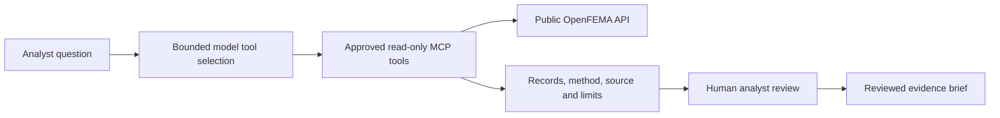

# FEMA Evidence & Oversight Graph

Read-only MCP tools for reviewing public FEMA Public Assistance funded-project records. Indicators carry their method, source context and limits; a human decides what they mean.

**Reviewers:** start with [SUBMISSION.md](SUBMISSION.md). The reference Databricks run has **64 passing tests, three exact control comparisons and 15/15 expected first-tool selections**. The displayed browser summary is assembled from tool evidence; 3/3 real review workflows passed. These narrow results do not establish general answer or filter accuracy. [Evaluation details](eval/evaluation_documentation.md).

## Five Tools

| Tool | Analyst goal | Important limit |
|---|---|---|
| `get_cost_share_anomalies` | Screen federal/total obligated ratios against a band | Band exceptions do not establish unauthorized cost share |
| `find_repeated_worksheets` | Find same-disaster/applicant/title/category groups | Exact-title matching is not proof of duplicate scope |
| `detect_category_outliers` | Compare amounts with a selected category baseline | Retrieved subset, not matched engineering costs |
| `explain_risk_indicator` | Read the calculation, thresholds and limits | Static card, not policy adjudication |
| `generate_evidence_brief` | Package selected project records | Supply full project identity; trigger is not independently revalidated |

Also exposed: `fema-pa://provenance` and `fema_oversight_review`.

## Architecture



The graph is a review workflow. The code uses a bounded tool loop, not a separate graph orchestration framework. Human review is an operating requirement, not an electronic sign-off gate.

## Run Locally

Python 3.11+ and `uv` are declared by the project. The reference run used Python 3.12.3.

```powershell
uv sync --group dev
uv run pytest tests/ -q
uv run ruff check .
$env:MCP_TRANSPORT = "streamable-http"
$env:MCP_HOST = "127.0.0.1"
uv run python main.py
```

Health: `http://127.0.0.1:8000/health`; MCP: `http://127.0.0.1:8000/mcp`. Default transport is stdio. The browser agent uses Databricks model authentication and is intended for the hosted environment.

## Databricks

- Source: `/Workspace/Users/phebe.arouni@hq.dhs.gov/2026-HACKATHON`.
- App: `2026h`; MCP path `/mcp`; health path `/health`.
- Notebook: `eval/databricks/HACKATHON_VALIDATION`.
- On-demand job: `67919837469456`.
- Reference evidence: `eval/results/20261029T111811Z/`.
- MLflow experiment: `1305734463288268`.

[Operations runbook](docs/OPERATIONS_RUNBOOK.md) covers deployment and reruns. No keys, secrets or bearer tokens belong in this repository.

## Source and Retrieval

[OpenFEMA Public Assistance Funded Projects Details v2](https://www.fema.gov/openfema-data-page/public-assistance-funded-projects-details-v2) is queried through its public API. No hard-coded current dataset total is claimed. Records can change after retrieval.

Cost-share screening retrieves at most 5,000 records; repeat and category screening retrieve at most 10,000. `data_scope.possibly_truncated` warns when a cap is reached. Output pagination pages screened results; it does not fetch additional source pages.

[Technical design](docs/TECHNICAL_DESIGN.md) | [Security](SECURITY.md) | [Known limits](docs/LIMITATIONS_AND_ROADMAP.md) | [Sources](SOURCES.md)

## October 29 evidence

The hosted browser completed a real cost-share review; authenticated health and a remote MCP methodology call passed. A small fixed-snapshot count comparison matched 15/15 tool results, while the model without source access abstained in all 15 trials. These are narrow checks, not general accuracy or load claims. Inspect `eval/results/20261029T111811Z/`.

## Attribution

The original Technology Transformation Services MIT license is retained in `LICENSE`. This does not imply agency endorsement, production authorization or compliance certification.
